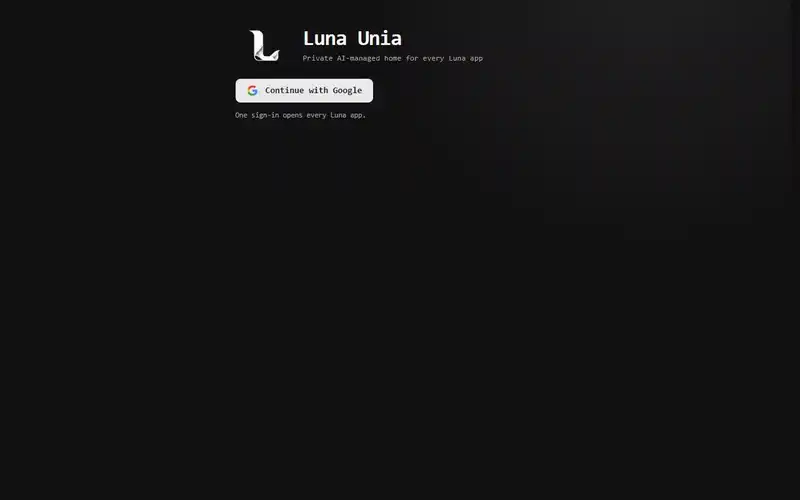
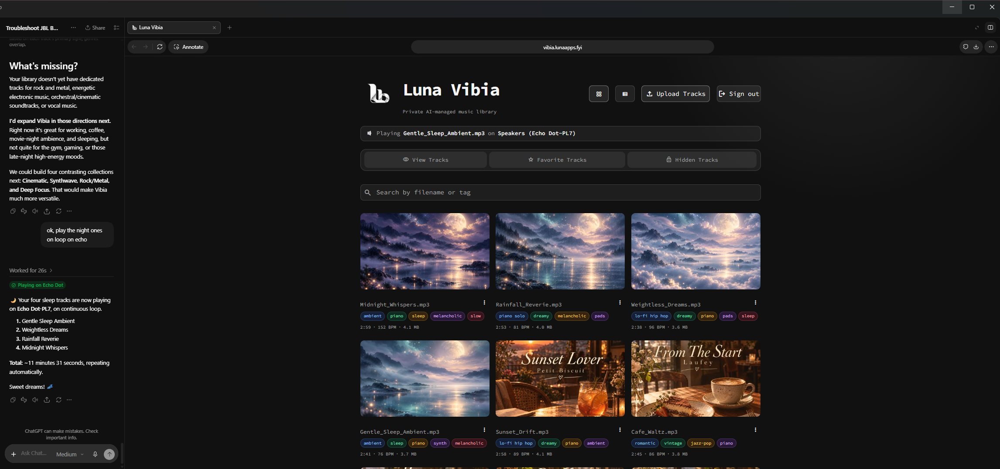

# Luna Vibia


**A private music library that listens to every track.** Store the music your AI assistant generates; Vibia hears
each track, captions and tags it, and finds what fits a request like "something for evening coffee", even when no
word matches. It plays in the browser or, when your assistant asks, on the host's speakers.

<p align="center">
  <a href="docs/assets/luna-vibia-showcase.mp4"></a>
</p>

<p align="center"><em>Searching and opening tracks, then an assistant making a playlist. Select it for the sharper
video.</em></p>

## What it does

- **Listens to every upload** with [CLAP](https://huggingface.co/laion/clap-htsat-unfused): tempo, key, energy, moods,
  genres and instruments, then a local model writes the caption and tags.
- **Search by sound or words**, ranked by what the music sounds like and what it is called.
- **Playlists:** saved and reordered, with shuffle and repeat; or ask for a mood and get a looping playlist.
- **A player that stays** above every tab while you browse, with one remembered volume.
- **Cover art** for every track, with its title on it; add your own with **Add cover**, or let your assistant
  generate one.
- **Play on the host's speakers** (an Echo Dot, say) from chat, with volume and speaker switching.
- **Work on many at once**, sort by relevance, date, name or size, and keep hidden tracks behind your PIN.

<p align="center">
  
</p>

## Quickstart

Vibia runs on [Luna Sentia](https://github.com/pranjallk1995/Luna_Sentia), which provides its database, caption
model and sign-in. On one machine you need no `.env`:

```sh
git clone https://github.com/pranjallk1995/Luna_Sentia.git
git clone https://github.com/pranjallk1995/Luna_Vibia.git
./Luna_Sentia/luna.sh start vibia
```

Open <http://localhost:18504> and sign in as Sentia's owner. Playing on the host's speakers also needs the speaker
helper, and a public address needs your own secrets: see
[Getting started](https://github.com/pranjallk1995/Luna_Vibia/wiki/Getting-Started).

## Connect your AI assistant

Add `https://<your vibia MCP host>/mcp` to Claude, ChatGPT or any MCP client as a custom connector (OAuth). An
assistant that generates a song uploads it straight away, then makes its cover. Every tool is listed in
[MCP tools](https://github.com/pranjallk1995/Luna_Vibia/wiki/MCP-Tools).

## Works with

- **[Luna Visia](https://github.com/pranjallk1995/Luna_Visia)** stores the cover art.
- **[Luna Lumia](https://github.com/pranjallk1995/Luna_Lumia)** reads what is playing, its mood and beats, so the
  lights can follow the music.

## Documentation

The [wiki](https://github.com/pranjallk1995/Luna_Vibia/wiki) has the full reference:

| Page | What's in it |
| --- | --- |
| [Home](https://github.com/pranjallk1995/Luna_Vibia/wiki) | What Vibia is |
| [Getting started](https://github.com/pranjallk1995/Luna_Vibia/wiki/Getting-Started) | Setup, `.env`, sign-in, the speaker helper, GPU listening |
| [MCP tools](https://github.com/pranjallk1995/Luna_Vibia/wiki/MCP-Tools) | Every tool your assistant can call |
| [Architecture](https://github.com/pranjallk1995/Luna_Vibia/wiki/Architecture) | How a track is processed, search, playlists, covers, models, data model and database diagram |
| [Development](https://github.com/pranjallk1995/Luna_Vibia/wiki/Development) | Modules, tests, model evaluations |
| [Operations](https://github.com/pranjallk1995/Luna_Vibia/wiki/Operations) | The database UI |

The UI follows [UI_STYLE_GUIDE.md](UI_STYLE_GUIDE.md).

## Releases and development

Releases are on the [Releases page](https://github.com/pranjallk1995/Luna_Vibia/releases). To update: `git pull`, then
`./Luna_Sentia/luna.sh start vibia`. To run your local code and reload it as you edit:
`./Luna_Sentia/luna.sh start --build --watch vibia`.
