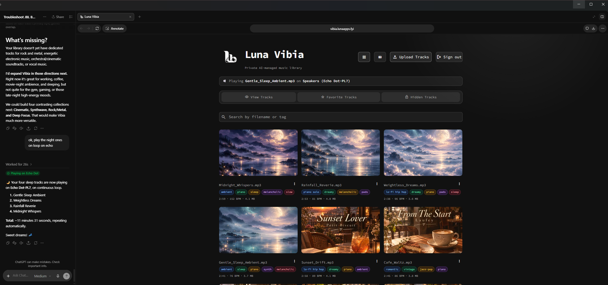
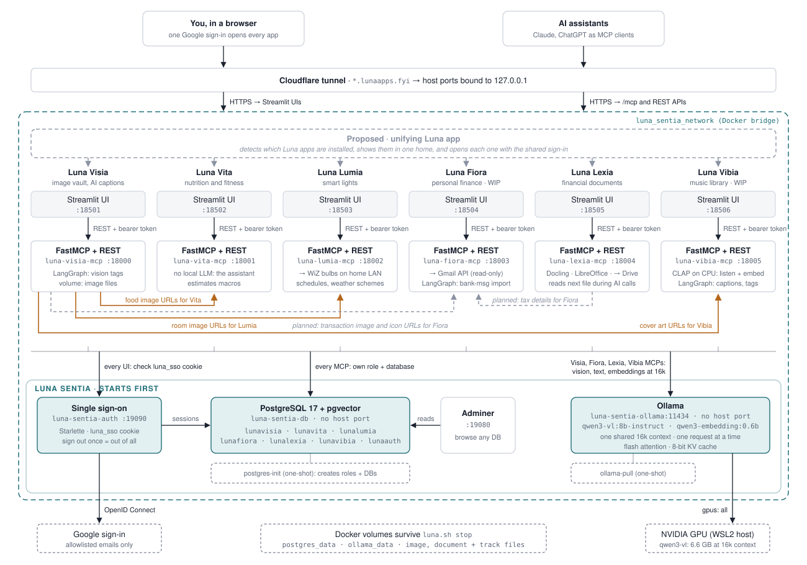

# Luna Vibia


## Store, describe, and find music with LLMs

> **Work in progress:** Luna Vibia is a local-first music library under active development. It
> can already play its tracks on the host's speakers when an LLM asks.

Luna Vibia is the music counterpart of [Luna Visia](https://github.com/pranjallk1995/Luna_Visia)
(images) and [Luna Lexia](https://github.com/pranjallk1995/Luna_Lexia) (documents). An
assistant that generates music stores it here; every track is listened to, measured,
captioned, and tagged locally, and embedded so that a request such as "something for
evening coffee" finds the tracks that sound right, even when no stored word matches.
The listening is done by [CLAP](https://huggingface.co/laion/clap-htsat-unfused)
(`laion/clap-htsat-unfused`), a model that puts music and text in one embedding space.
It ships inside Vibia's image, so there is nothing to install. It uses an NVIDIA GPU
when there is one and the CPU otherwise; Luna Sentia's model writes only the captions.
Cover art comes from Luna Visia.

<p align="center">
  
</p>

## Architecture

### Luna ecosystem



Every Luna app is a Streamlit UI plus a FastMCP service on Luna Sentia's
`luna_sentia_network`: its data lives in Sentia's PostgreSQL, people sign in
through Sentia's `auth`, and model calls go to Sentia's Ollama. Orange lines are
Visia image URLs that other apps use: food images for Vita, room images for
Lumia, and cover art for Vibia. Grey dashed lines are planned: links into Fiora
(tax details from Lexia, transaction image and icon URLs from Visia). Luna Unia
is the one home for all of them, on port 42069: it checks which Luna stacks are
running and opens each one with the shared sign-in. The purple line is the mood and
beats of the track Vibia plays, which Lumia's lights follow.

| Component | Technology | Purpose |
| --- | --- | --- |
| UI (`luna-vibia-ui`, `:18506`) | Streamlit | Gallery and list views, track dialog with player, 4.5:3 cover, and inline editing |
| MCP (`luna-vibia-mcp`, `:18005`) | FastMCP + REST, LangGraph | Upload, analysis, search, playlists, covers; the UI calls it with a bearer token |
| Listening | CLAP (GPU or CPU), librosa, ffprobe | Embedding, matched moods and instruments, tempo, key, energy |
| Captions | Sentia's Ollama (`CAPTION_MODEL`, text only) | Caption and tags from what CLAP heard and the measurements |
| Storage | Sentia's PostgreSQL (`lunavibia`, pgvector) and a track volume | Metadata, embeddings, full-text index; the audio files |
| Covers | Luna Visia | Images by immutable ID URL, fetched over `luna_sentia_network` |

## How a track is processed

```text
Upload (UI, MCP tool, upload link, or HTTP API)
  -> measure    ffprobe: format, duration, embedded tags; librosa: tempo, key, energy
  -> listen     CLAP (laion/clap-htsat-unfused, GPU or CPU): one embedding for the sound, plus
                the moods, genres, instruments, and settings it matches
  -> provenance tags naming an AI generator (Suno, Udio, Lyria, MusicGen, ...) -> "ai info"
  -> describe   Luna Sentia's model (Qwen3-VL, text only) writes a caption and tags from
                what CLAP heard, the measurements, and any title, artist, or generator notes
  -> store      the file in the track volume; metadata and the embedding in PostgreSQL
```

The steps run as a LangGraph graph (`mcp/app/services/analysis_graph.py`): listen and
the provenance check run in parallel after measuring. The caption model never hears
the audio; it turns the evidence into words, and is told to keep only matches that
agree with each other and the measurements.

- **CLAP** maps music and text into one 512-dimensional space. A track is heard as up
  to six 10-second clips spread over its length, whose embeddings are averaged. It
  runs on the GPU when there is one and on the CPU otherwise (see
  [GPU listening](#gpu-listening-optional)); the weights are baked into the image.
- **Generator notes** are the strongest signal: when an assistant generated the music,
  it should pass the prompt or style it used as `notes` with the upload. They are stored
  and used for the caption.

## Search and playlists

Search embeds the request with CLAP's text side and ranks every visible track by its
cosine similarity to the sound, blended with the full-text rank of its name, caption,
title, artist, and tags (75% meaning, 25% words; `SEMANTIC_WEIGHT` in
`mcp/app/core/config.py`). Tags and minimum or maximum length narrow the results.

`suggest_playlist` turns a mood into a looping playlist: it takes the 60 best matches,
drops those well below the best one, then picks tracks one at a time by how well they
fit minus how much they sound like the tracks already picked, until the requested
length is filled. With too little fitting music it returns a shorter playlist and says
to loop it.

## Cover art from Luna Visia

When a model generates a song for Vibia, it also generates cover art and passes both to `upload_track` in one call: the audio as `file` and the art as `cover_file` (or as an image URL in `cover_url`, or `cover_content_base64`). The server's MCP instructions and the tool's description both ask for this. The track is saved first, and then the art is stored in Luna Visia and set as its cover. If the art cannot be stored, the track stays saved with the placeholder and the result's `cover_error` says to retry with `update_track_cover`. If the upload is retried and comes back as a duplicate that still has the placeholder, the new art is applied to it. Uploads through `create_upload_link` return a `cover_hint` asking for the art.

To generate cover art, ask in chat (for example "make a cover for Midnight_Cafe"). A model that can generate images creates one and passes it to `update_track_cover`. Luna Vibia sends it to Luna Visia, which stores, captions, and tags it (`cover art`, `luna vibia`, the track's name), then sets Visia's stable public URL as the cover. If Visia cannot store the image, the cover stays as it was. A retried call with the same image returns the stored copy instead of a duplicate. Uploads without a cover get a `cover_hint` that asks for generated art. Storing covers needs `LUNAVISIA_COMPANION_TOKEN`, set to the same value here and in Luna Visia.

A track's cover is an image stored in Luna Visia. `set_track_cover` (or **Cover art**
in a track's dialog) accepts only Visia's immutable image-ID URLs
(`.../api/public/images/<image-id>`), checks that the image exists and is visible in
Visia, and stores Visia's canonical public URL. The model always searches Visia for an image that suits
the track before uploading and passes it to `upload_track` as `cover_url`; when none
fits, it omits the URL and the track gets the Luna Vibia audio placeholder, an image stored in Visia itself (set its image ID
with `LUNAVIBIA_PLACEHOLDER_COVER_ID`; while that is blank the cover stays empty). The UI
fetches covers from Visia over `luna_sentia_network`; tracks without one show a generated
placeholder. Visia must be running for covers to be set or shown.

## Start

Start [Luna Sentia](https://github.com/pranjallk1995/Luna_Sentia) first and wait until it
is healthy. Sentia's PostgreSQL holds Vibia's `lunavibia` database (with pgvector) and its
Ollama serves the caption model.

```sh
cd ../Luna_Sentia
docker compose up -d --wait postgres ollama adminer
docker compose run --rm postgres-init   # creates the lunavibia role and database
```

`LUNAVIBIA_DB_PASSWORD` in Sentia's `.env` must equal `POSTGRES_PASSWORD` in Vibia's.
To start Sentia and every Luna app together, use `../luna.sh start`; see the
[Sentia README](https://github.com/pranjallk1995/Luna_Sentia#start-everything).

Create a private `.env` from `.env.example`:

```dotenv
POSTGRES_PASSWORD=replace-with-a-private-database-password
CAPTION_MODEL=qwen3-vl:8b-instruct
CLAP_DEVICE=auto
LUNAVISIA_API_URL=http://luna-visia-mcp:8000
LUNAVIBIA_PUBLIC_BASE_URL=https://vibia.example.com
LUNAVIBIA_API_TOKEN=replace-with-a-random-value-of-at-least-32-characters
LUNAVIBIA_ALLOWED_EMAILS=you@example.com
MCP_PUBLIC_URL=https://vibia-mcp.example.com
PULSE_SOCKET=/mnt/wslg/PulseServer
LUNAVIBIA_SPEAKER_HELPER_URL=http://host.docker.internal:18007
LUNAVIBIA_PLACEHOLDER_COVER_ID=
LUNA_SSO_URL=https://auth.example.com
LUNA_SSO_INTERNAL_URL=http://luna-sentia-auth:8000
```

- `LUNAVIBIA_API_TOKEN` is a shared secret between the UI and the MCP server; generate
  one with `openssl rand -hex 32`.
- `LUNAVIBIA_PUBLIC_BASE_URL` is the HTTPS origin of playable track URLs
  (`.../api/public/tracks/<track-id>`); route it to `127.0.0.1:18005`.
- Sign-in goes through Luna Sentia's single sign-on, as in every Luna app; see
  [Single sign-on](https://github.com/pranjallk1995/Luna_Sentia#single-sign-on).

```sh
docker compose up -d
```

- UI: <http://127.0.0.1:18506>
- Service health: <http://127.0.0.1:18005/health>
- MCP endpoint: <http://127.0.0.1:18005/mcp>

### GPU listening (optional)

A GPU is not required: without one, CLAP runs on the CPU, and a track takes about
0.6 s longer to hear. With an NVIDIA GPU, the `mcp` service is given it (`gpus: all` in
`docker-compose.yaml`) and CLAP runs there. On an RTX 5070, hearing a 45-second track
takes about 0.3 s instead of 0.9 s (preparing the clips stays on the CPU either way),
using about 0.85 GB of GPU memory beside Ollama's model. Search embeds only a short text, which is quick either way.

- **No NVIDIA GPU:** remove `gpus: all` from the `mcp` service, or Docker refuses to
  start it. Nothing else changes.
- **`CLAP_DEVICE`:** `auto` (the default) uses a CUDA GPU when one is visible and the
  CPU otherwise; `cuda` or `cpu` force one. `cpu` keeps CLAP off a GPU you want to
  leave to Ollama.
- **Moving between them** needs no re-analysis: CLAP runs in full precision on both, so
  embeddings made on the GPU match those made on the CPU.

CLAP keeps its place on the GPU. Luna Lexia's Docling reads a document on the CPU
whenever the GPU has less than 2 GB free, and releases its working memory after every
document. If a CLAP call still finds the GPU full, it tries twice more, 1 s and then 2 s
later, while Docling finishes its document, then runs that call on the CPU.

## MCP tools

### Find and play

- `search_tracks` - rank tracks for a description ("upbeat electronic for a run"), with optional tags and length limits.
- `suggest_playlist` - a looping playlist for a mood or moment, about `minutes` long, without near-duplicates.
- `list_tracks` - visible tracks newest first, with captions, facts, `cover_url`, and playable `public_url`.
- `get_track_url` - the playable public URL of one track.

### Play on the host's speakers

- `play_tracks` - play tracks out loud, in order and optionally looped, on a speaker of the machine running Vibia. With several speakers connected and none named, nothing plays: it returns `choose_speaker` and the options so the LLM asks which one.
- `list_speakers` - the connected speakers (under WSL, Windows' Bluetooth speakers), with the current output marked.
- `switch_speaker` - move what is playing to another speaker; the current track resumes there at the second it had reached. `play_tracks` with the same queue does the same instead of restarting.
- `get_volume`, `change_volume`, `set_volume` - the volume (0-100) of the speaker the host plays on now: read it, turn it up or down (`by`, e.g. 10 or -10), or set it and mute or unmute it. Under WSL this is Windows' volume for that output, which a Bluetooth speaker follows, so everything playing on it changes.
- `get_playback_status` / `stop_playback` - what is playing (with `position_seconds` into the current track, and `track`: its caption, tags, tempo, and key), and stop it.

[Luna Lumia](https://github.com/pranjallk1995/Luna_Lumia) reads the same status from `GET /api/playback?output=0`
(`output=0` skips asking Windows for its current speaker) to light the room for each
track's mood, for example soft light blues with slow fades for a loop of sleep tracks.
For beat pulses it also reads `started_at`, the Unix time of the playing track's second 0,
and `GET /api/tracks/{name}/beats`: the beat times (seconds) and strengths (0-1) of the
whole track, which librosa works out the first time a track is asked for (about two
seconds) and the `track_beats` table keeps by file content.

The MCP container plays through the host's PulseAudio (or PipeWire) server, whose
socket `PULSE_SOCKET` mounts into it. On Linux, set it to `/run/user/1000/pulse/native`
(your user ID in place of 1000) and leave `LUNAVIBIA_SPEAKER_HELPER_URL` blank: every
speaker is listed.

Under WSL (the default, `/mnt/wslg/PulseServer`), WSLg exposes one output that plays on
Windows' default device, so a small helper on the WSL host picks the speaker:
`host/speaker_helper.py` lists Windows' connected Bluetooth speakers and, when the LLM
names one ("play something calm on the echo dot"), makes it Windows' default output
(through `host/windows_audio.ps1`); WSLg's audio follows. It uses only the Python
standard library and the shared `LUNAVIBIA_API_TOKEN`. Install it once as a user
service, from this directory:

```sh
mkdir -p ~/.config/systemd/user
sed "s#@VIBIA_DIR@#$PWD#g" host/luna-vibia-speakers.service > ~/.config/systemd/user/luna-vibia-speakers.service
systemctl --user daemon-reload && systemctl --user enable --now luna-vibia-speakers
```

The container reaches it at `LUNAVIBIA_SPEAKER_HELPER_URL`
(`http://host.docker.internal:18007`). Listing takes about 5 seconds, as PowerShell
reads Windows' devices. Restart Vibia after the host's sound server restarts (for
example after `wsl --shutdown`).

### Add and change

- `upload_track` - add MP3, WAV, FLAC, OGG/Opus, or M4A from a chat attachment (`file`), `track_url`, or `content_base64`, with optional `title`, `artist`, and generator `notes`, and cover art: a generated image as `cover_file`, `cover_url`, or `cover_content_base64` (stored in Luna Visia), or an existing Visia `cover_url`. Without one, the track gets the audio placeholder. Names are corrected and deduplicated like Visia's.
- `create_upload_link` - a single-use HTTPS link to POST a local file to (up to 200 MiB).
- `modify_track` - replace a track's audio; title, artist, notes, and cover are kept.
- `set_track_cover` - set the cover to a Luna Visia image, or to the audio placeholder when none fits.
- `update_track_cover` - store generated or attached cover art in Luna Visia and set it as the cover in one call.
- `update_track_metadata` / `update_tracks_metadata` - edit captions and tags.
- `rename_track` / `rename_tracks`, `set_favorite_tracks`, `remove_track`.

### Metadata and library

- `get_track_metadata` / `list_track_metadata` - stored, measured, and embedded details, including AI-generator signals.
- `get_library_stats` - counts, listening time, formats, covers, and top tags.
- `download_tracks` - a 24-hour ZIP link to the original files.
- `backfill_metadata` - analyze files missing current metadata.
- `set_public_base_url` - change the public origin and regenerate every track URL.

## Data model

`track_metadata` holds one row per track: name, immutable `track_id`, size and SHA-256,
caption and tags, title, artist, generator notes, format, duration, sample rate,
channels, bitrate, tempo, key, energy, `cover_url`, the CLAP `embedding` (pgvector, HNSW
cosine index), a weighted full-text `search_vector`, and the hidden, favorite, and
public-URL fields. `vault_security` and `vault_config` are as in Luna Visia.

## Database UI

Use [Adminer in Luna Sentia](https://github.com/pranjallk1995/Luna_Sentia#database-ui) at
<http://127.0.0.1:19080>: server `luna-sentia-db`, username and database `lunavibia`,
password your `POSTGRES_PASSWORD`.

## Development workflow

```sh
docker compose up -d --build
docker compose exec mcp python -m unittest discover -s tests
```

Tests use fake CLAP and caption models and real ffmpeg, so they run in the MCP image
without the model weights being loaded.
